# Account area and order detail design note

Decided 2026-11-04 in the group 3 prototype session (the group had no parent issue when this was
written; the parent copies these decisions). This is the document the shopper order detail,
account shell, profile, change-password and self-deactivation tickets follow. The prototype itself
is the primary source: tag
[`prototype-group-3`](https://github.com/t-bendet/audiophile-ecommerce-v5/tree/prototype-group-3),
on the real `/account/*` routes plus a nested `/account/orders/:orderId`, run with `pnpm dev` and
opened at `/account/orders`. Its README explains the floating bar. It is throwaway code and is
never merged. Screenshots are in [`account-and-order-detail-design/`](account-and-order-detail-design/).

## Verdict

**Shell A, detail B, profile A, security A**, with the card's heading as the link, the actor
hidden, and tracking inside the Shipped event.

Rejected: **shell B**, a sidebar card and vertical nav (three links do not need a column, and the
phone fallback is a pill row that clips); **shell C**, a dark band with "Hello {name}" and pill
tabs (it repeats the nav's greeting and pushes the content below the fold); **detail A**, a
receipt with a horizontal stepper (the four step labels collide on a phone, and Cancelled needs
a second component); **detail C**, a tracker hero with a newest-first history and folded items
(strong only for Shipped, and the items are the thing most shoppers open the page for);
**profile B**, a hub of cards with an edit dialog and recent orders (two routes already own
those); **security B**, cards opening dialogs with a typed "DEACTIVATE" (a typed word proves
intent, not identity).

## Decisions

### Order detail route

`/account/orders/:orderId`, a child of the account layout, so the shell and the Orders tab stay.
The loader awaits `GET /orders/:orderId` through `getOrderQueryOptions` under `PendingOutlet`'s
progress bar ([ADR 0013](../adr/0013-a-storefront-navigation-keeps-the-old-page-under-a-progress-bar.md)).
An unknown id, or another shopper's id, reaches the route boundary as not found
([ADR 0008](../adr/0008-a-route-the-role-cannot-reach-is-not-found.md)). `useOrder` and `useOrders`
stay unused and are deleted.

### Order detail layout (B)

An "Orders" back link with the arrow, as the admin detail has. Then the heading row: "Order
#XXXXXXXX" (the last eight characters of the id, upper-cased, as the admin's `shortOrderId`), a
"Placed {date} · {total}" line, and the status badge on the right. The badge is the admin's
`OrderStatusBadge`; it moves to a shared component.

From `lg` a two-column grid, `minmax(0,1fr) 20rem`. Left: the Items panel (lines with the image,
name, unit price × quantity and subtotal; then Subtotal, Shipping, Tax and an orange Grand total),
then Ships to and Billed to side by side; Billed to ends with "{paymentMethod} · {paymentStatus}".
Right, sticky at `top-6`: the Status panel, then "Something wrong with this order? Contact us".
Below `lg` the Status panel comes first, then items, then addresses. Panels are `bg-neutral-200`
with `rounded-lg p-6` and an overline title in `text-neutral-500`; the admin's `OrderSummary` is
the model, rebuilt on `OrderDTO` without the Customer panel.

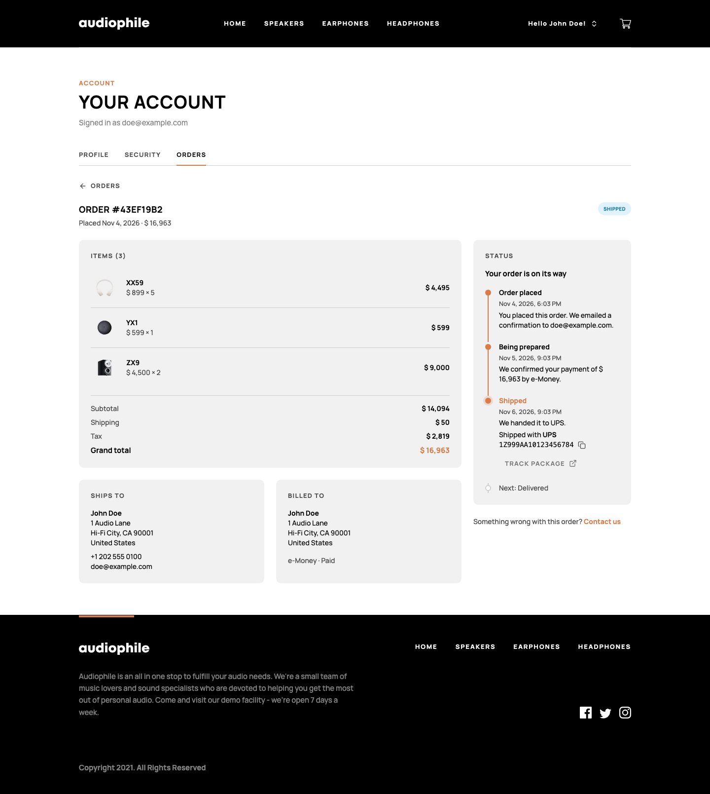

### Status timeline

The Status panel opens with a headline per status:

| Status     | Headline                     |
| ---------- | ---------------------------- |
| Pending    | We have received your order  |
| Processing | Your order is being prepared |
| Shipped    | Your order is on its way     |
| Delivered  | Your order was delivered     |
| Cancelled  | This order was cancelled     |

Under it, a vertical timeline, oldest first: an orange dot per event joined by an orange line, the
last dot ringed, with the title in bold (orange for the current event), the date and time in
`text-xs text-neutral-500`, and one sentence of detail. After the last event, a hollow dot and
"Next: {step}" when the ladder continues. Cancelled renders "Order placed" then "Cancelled"; no
future step. The step titles are Order placed, Being prepared, Shipped, Delivered, Cancelled.

The order gains a status history: one event per status write, holding the status, the time, the
actor (a user id or `system`) and, on Shipped, the tracking number and carrier. The creation
writes the Pending event. The admin fulfilment form's status PATCH appends the next one.

**The actor is never shown as a name.** The shopper reads the event's sentence, whose subject is
the actor: "You placed this order. We emailed a confirmation to {email}."; "We confirmed your
payment of {total} by {method}." or "You pay {total} in cash when it arrives."; "We handed it to
{carrier}."; "{carrier} confirmed delivery in {city}." for a `system` event; "We cancelled this
order. {total} will be refunded to your {method} account." or "... Nothing was charged." The admin
who moved the status is an admin-side fact. Rejected: a "· You / Audiophile / Carrier update"
suffix on each date line (prototyped as `actor=shown`), which adds a label the sentence already
carries.

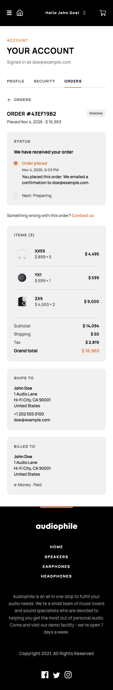
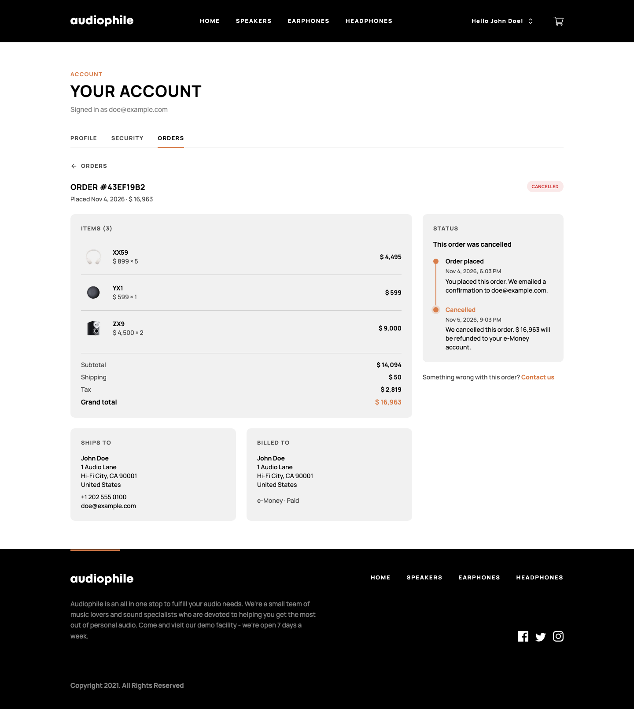

### Tracking and carrier

Captured by the admin at Shipped as two free-text fields, tracking number and carrier, both
required for the move to Shipped. They appear once, inside the Shipped event: "Shipped with
**{carrier}**", the number in `font-mono` with a copy button ("Copy tracking number", a
"Tracking number copied" toast), and a "Track package" link in the `link` button style that opens
the carrier's tracking page in a new tab. The link renders only when the carrier matches a known
list (the prototype shows UPS); an unknown carrier shows the number without a link. The admin
detail shows the same block in its Fulfilment panel. Rejected: a tracking panel outside the
timeline (detail A) and a tracker hero (detail C), both of which repeat the number.

### Orders list and the card link

The list page keeps its article cards. The card's heading becomes "Order #XXXXXXXX ›", a link to
the detail page, with "Ordered {date} · {method} · {paymentStatus}" under it and the status badge
on the right. The product-name headings, the article role and the payment-method text stay, so
`order.spec.ts` keeps its locators. Rejected: a "View order" outline button in the footer (the
heading is already the natural target, and the button adds a second control per card).

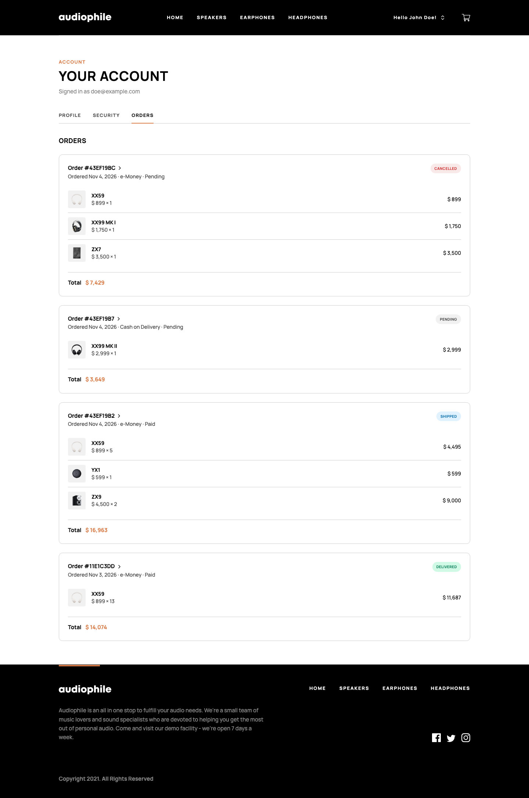
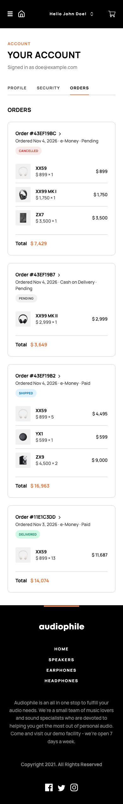

### Account shell (A)

The storefront type scale on the content layout, in `text-neutral-900`, which also fixes the
invisible "Account Settings" heading from #359: the orange overline "Account", the h1 "Your
account" in `text-2xl md:text-3xl font-bold uppercase tracking-300`, and "Signed in as {email}" at
`opacity-50`. Below, a `<nav aria-label="Account">` of three `NavLink`s, Profile, Security and
Orders, as overline text with a 2px underline, orange on the active one, on a `neutral-400`
baseline. The page content starts 2rem under the baseline.

The active tab is `NavLink`'s prefix match, so `/account/orders/:orderId` keeps Orders active.
The Radix `Tabs` and the `pathname.replace` go; `TAccountPathKeys` goes with them. `/account`
still redirects to the profile page. The user menu's links are unchanged.

### Profile (A)

The page a recovered shopper lands on after a reset (#355) and after signup or login without a
redirect. Heading "Profile", "Member since {date}" under it, then one form at `max-w-md`: Name
and Email in the auth label and input styles, the hint "You sign in with this email. Order emails
go to the address on each order." under Email, and an orange "Save changes" button at its own
width. Save calls `PATCH /users/updateMe`, shows a "Profile updated" toast, and updates the
`/users/me` cache so the nav greeting follows. Field errors land on the fields
([ADR 0006](../adr/0006-server-validation-errors-belong-to-the-form.md)). Nothing else on the page.

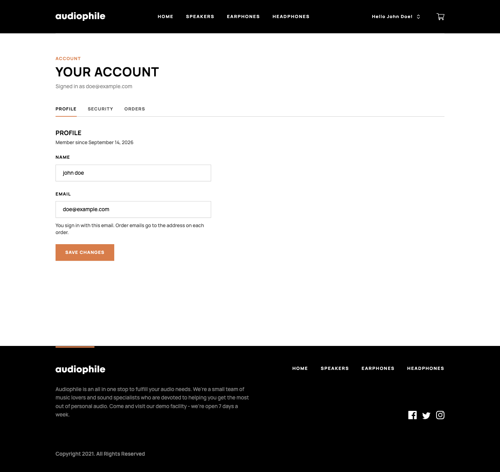

### Security (A): change password

Heading "Change password" with the line "Changing your password signs you out of every other
device. This one stays signed in." Then, at `max-w-md`: Current password, New password with the
signup strength meter and the "Between 8 and 20 characters." hint, Confirm new password, and an
orange "Update password" button. Submit calls `PATCH /auth/updateMyPassword` with the three
values; success resets the form and toasts "Password updated" with "Every other device has been
signed out." A wrong current password is a field error on Current password.

### Security (A): self-deactivation

Under the form, a section outlined in `primary-700/30` with the overline "Deactivate account" in
`primary-700`, the copy "Deactivating signs you out everywhere and closes your account to sign-in.
Your orders stay on record. Contact us if you want it reactivated.", and an outline "Deactivate
account" button.

The button opens a `centred` dialog ([ADR 0014](../adr/0014-every-dialog-is-one-radix-primitive-with-a-placement.md))
with the close button: title "Deactivate your account?", the same copy as its description, one
"Your password" field, then "Keep my account" (outline) and "Deactivate" (destructive). **The
password is required**: `DELETE /users/deleteMe` gains a `password` body field and refuses a
wrong one as a field error, so a borrowed session cannot close the account. On success the client
marks itself signed out, navigates home with `replace`, and toasts "Account deactivated" with
"You have been signed out. Contact us to reactivate." Deactivation is the one write that signs out
the current session too.

The sole active admin cannot deactivate: the server refuses with the forbidden code the admin
self-deactivation guard uses (#344), and the page renders the button disabled with "You are the
only active admin. Make another user an admin from the dashboard before deactivating this
account." under it, as `aria-describedby`.

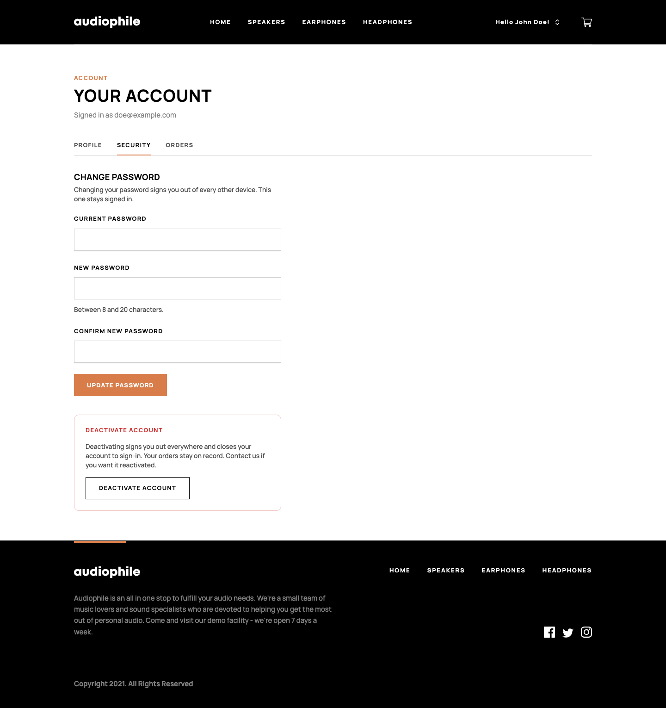
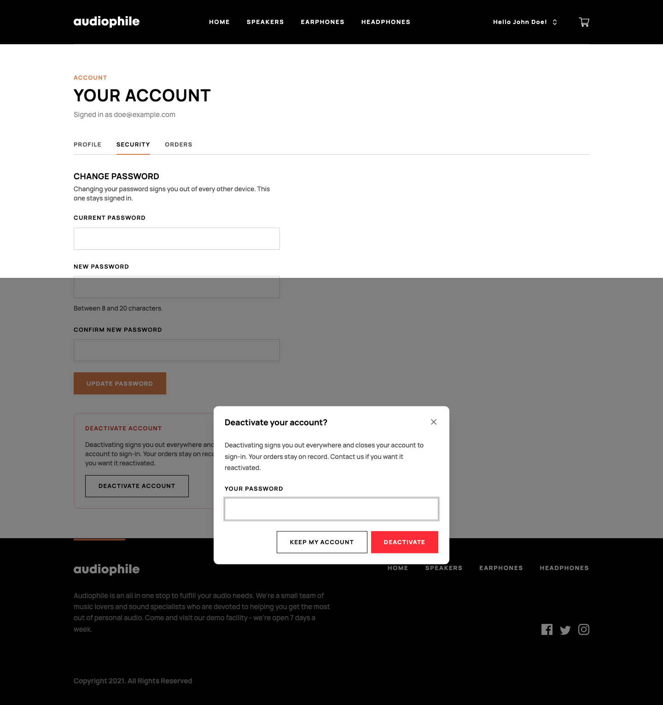
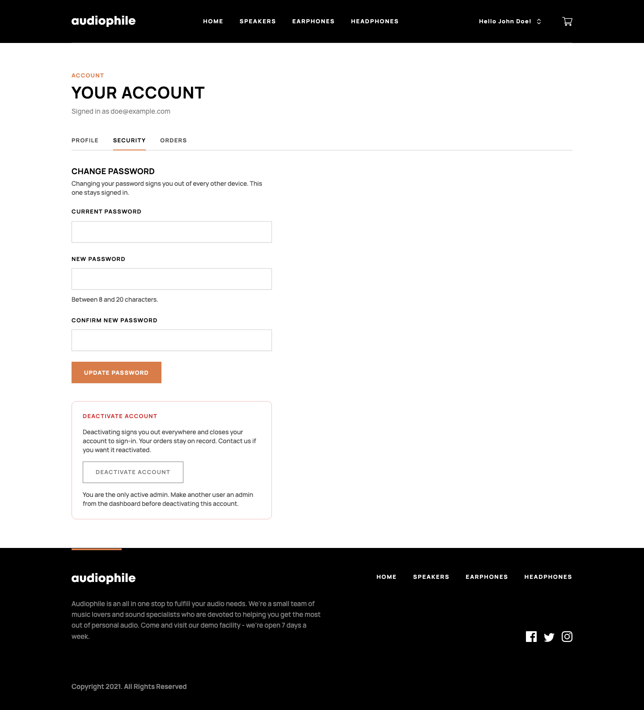

### Emails

Yes, they link. The order-received email gains a "View your order" link to
`<CLIENT_URL>/account/orders/{id}` above the items. Two status emails join it, both with the same
link: "Your order has shipped" at Shipped, carrying the carrier and tracking number, and "Your
order was cancelled" at Cancelled, carrying the refund line. Processing and Delivered send
nothing. A link in an email lands on the login page when signed out; `redirectTo` brings the
shopper back.

## Rejected variants

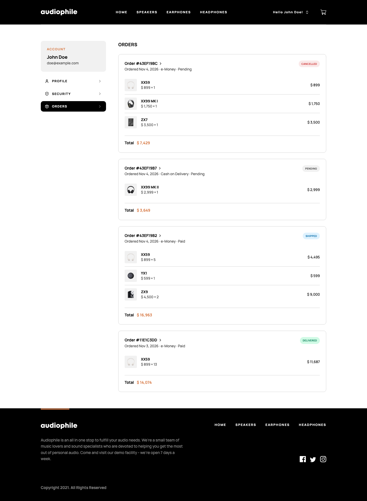
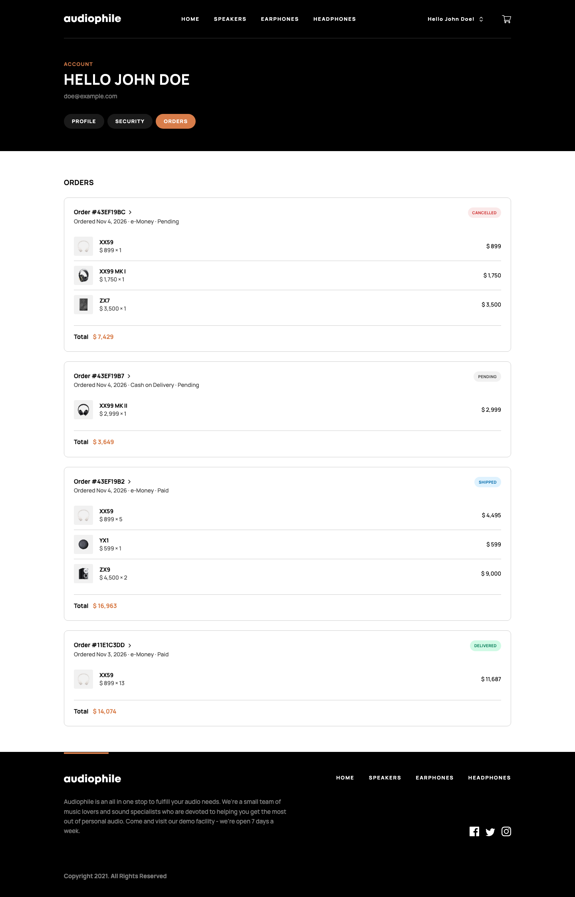
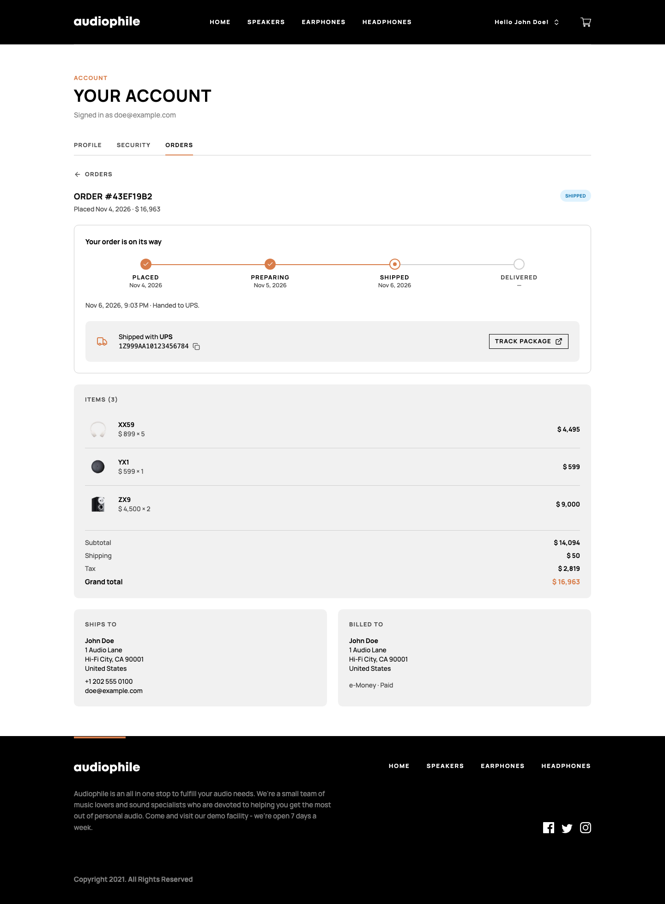
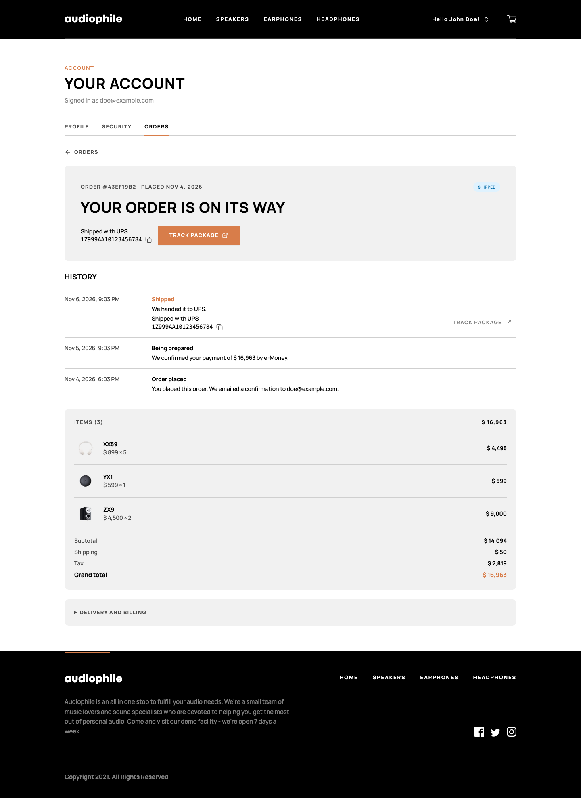
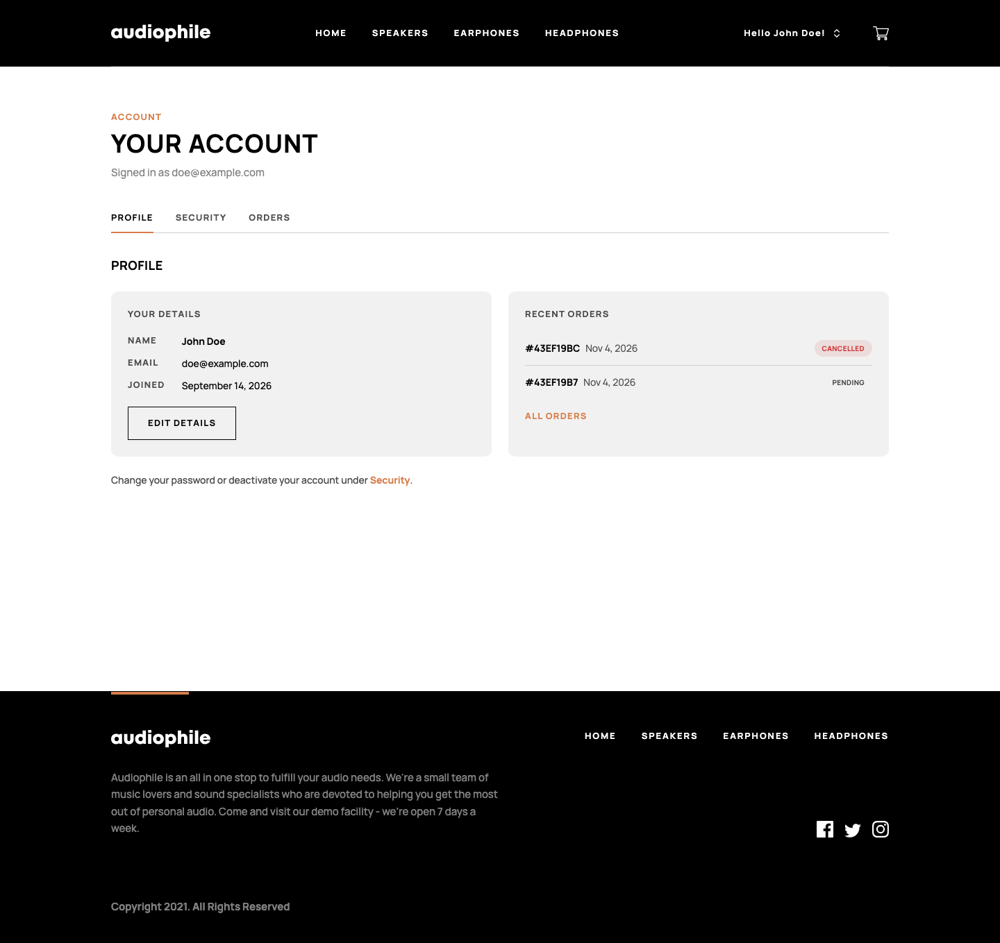
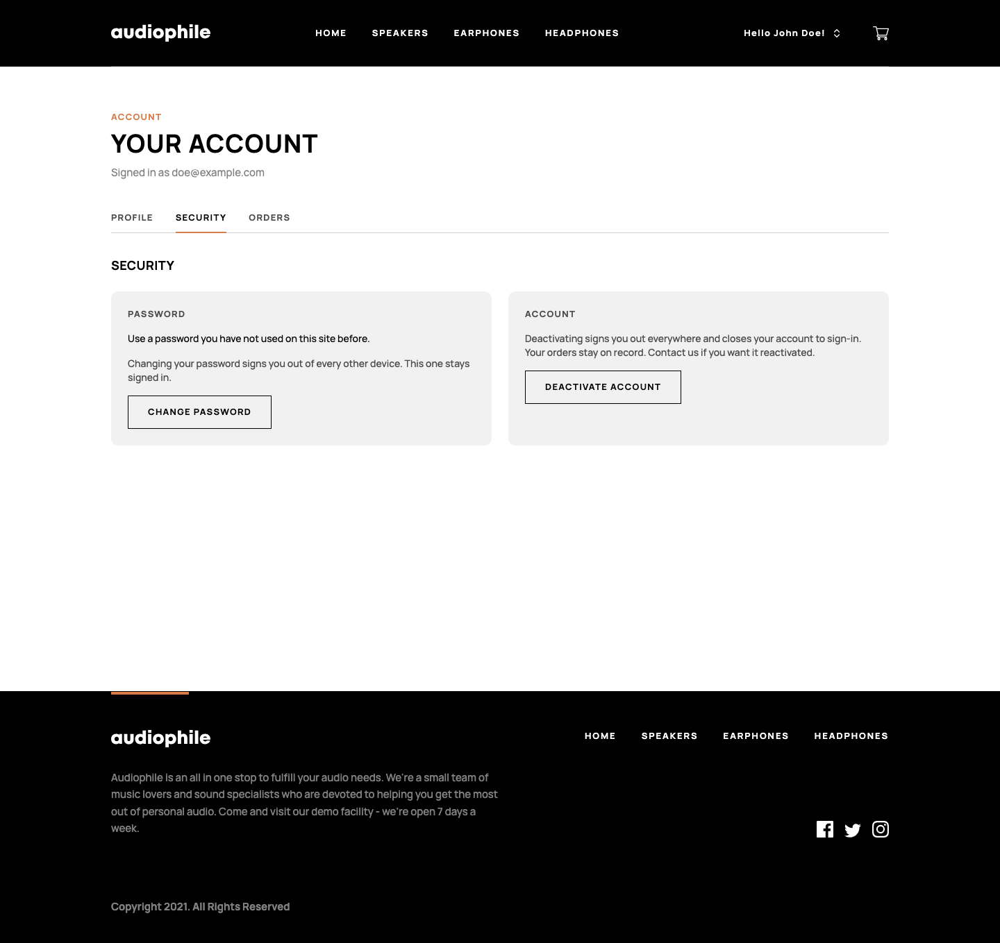

## Reference implementation

The chosen variants exist as working code on the prototype tag, under
`apps/client/src/components/prototype/account-orders/`. Lift them, minus the variant switching:

- `shell.tsx`: `ShellA` and the `LINKS` nav, replacing `user-area-layout.tsx`.
- `order-detail.tsx`: `DetailB`, `VerticalTimeline` and the loader; `order-parts.tsx` for the
  panels, the tracking block and `EventLine`. `timeline.ts` synthesises the history from
  `createdAt`; the real page reads the order's stored events.
- `orders-list.tsx`: the card with `link === "heading"`.
- `profile.tsx`: `ProfileA`, wired to `PATCH /users/updateMe`.
- `security.tsx`: `SecurityA`, `DeactivateWithPassword` and `SoleAdminNotice`, wired to the two
  endpoints.

## Findings from the prototype

- **The storefront's greys are not shadcn's.** `neutral-100` is white and `neutral-900` is black,
  so the admin's `bg-neutral-100` panels vanish on a storefront page. Storefront panels use
  `bg-neutral-200` and dividers `neutral-400`.
- **A stale Vite process hides every change.** The dev server left from before the dependency
  upgrades answered `index.css` with a 500 for a removed Tailwind path. A prototype session should
  start its own client on a fresh port when one is already listening.
- **The seeded shopper has no orders.** The session placed four through the API and moved them
  with the seeded admin, one per status family. An E2E for the detail page should place its own.
